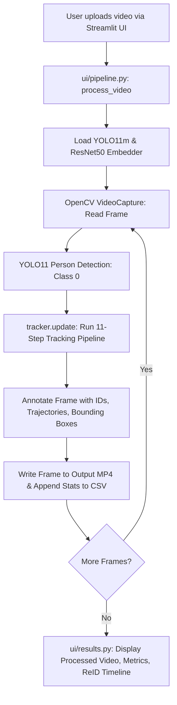
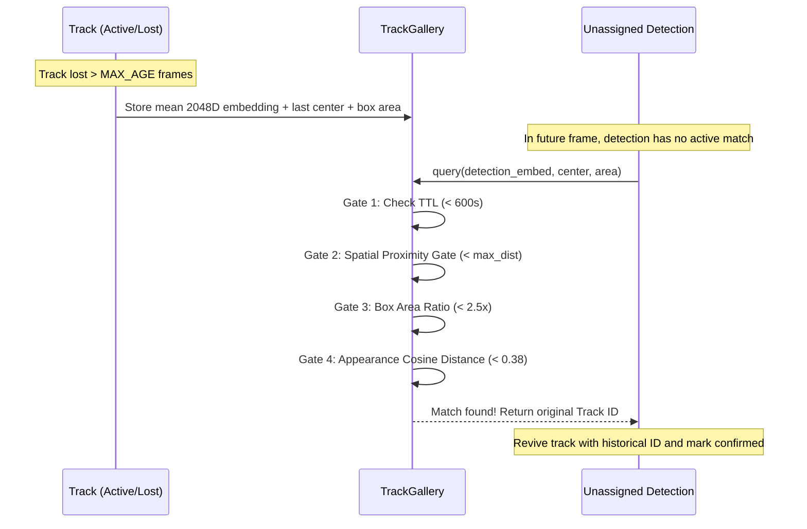

# VisionTrace AI / Person Re-ID Tracking — System Summary & Flow

## Table of Contents
1. [Project Overview & Architecture](#project-overview--architecture)
2. [End-to-End Execution Flow](#end-to-end-execution-flow)
3. [Per-Frame Tracking Pipeline (11 Steps)](#per-frame-tracking-pipeline-11-steps)
4. [Long-Term Re-Identification & Track Gallery Flow](#long-term-re-identification--track-gallery-flow)
5. [Recent Bug Fixes & Code Improvements](#recent-bug-fixes--code-improvements)

---

## Project Overview & Architecture

VisionTrace AI is a high-accuracy, real-time person detection, tracking, and multi-camera Re-Identification (ReID) system. It combines **YOLO11** object detection, **ResNet50 part-based appearance embeddings**, **Kalman filtering**, **global Hungarian bipartite matching**, and a **persistent Track Gallery** with spatial/temporal gating.

### Component Architecture & Dependency Direction
The codebase strictly decouples tracking algorithms from the user interface:
```
Streamlit App (app.py) ──► UI Modules (ui/*) ──► Tracking Core (tracker/*)
```

| Component | Path | Core Responsibility |
|---|---|---|
| **Entry Point** | `app.py` | Initializes Streamlit session state, global styling, page layout |
| **Pipeline Runner** | `ui/pipeline.py` | Orchestrates video decoding, frame inference loop, drawing annotations, CSV export |
| **UI Components** | `ui/sidebar.py`, `ui/uploader.py`, `ui/results.py` | Parameter controls, video upload/previews, analytics, video players |
| **Tracker Coordinator** | `tracker/reid_tracker.py` | High-level tracker running the 11-step tracking lifecycle per frame |
| **Track State** | `tracker/track.py` | Manages individual track lifecycle, Kalman state, adaptive smoothing, feature cache |
| **Kalman Filter** | `tracker/kalman.py` | Constant-velocity motion model predicting 8D box state `[cx, cy, w, h, vx, vy, vw, vh]` |
| **Feature Embedder** | `tracker/embedder.py` | Extracts 3-part (head, torso, legs) 2048D L2-normalized embeddings using ResNet50 |
| **Track Gallery** | `tracker/gallery.py` | Maintains appearance vectors of retired tracks to re-attach returning persons |
| **Math / Utils** | `tracker/utils.py` | Stateless box conversions, IoU, center distance, cosine distance |
| **Configuration** | `tracker/config.py` | Single source of truth for thresholds, weights, time-to-live, and geometry |

---

## End-to-End Execution Flow



---

## Per-Frame Tracking Pipeline (11 Steps)

Every video frame is processed through `PersonReIDTracker.update(frame, detections)` using the following sequence:

```mermaid
flowchart TD
    S1[Step 1: Detection Filtering<br/>Low floor 0.12, High threshold 0.45] --> S2[Step 2: Part-Based Embedding<br/>Split box into 3 strips -> ResNet50 2048D]
    S2 --> S3[Step 3: Kalman Prediction<br/>Predict new position & velocity for all active tracks]
    S3 --> S4[Step 4: Cost Matrix Construction<br/>Cost = 0.3*(1-IoU) + 0.5*ReID + 0.2*Direction]
    S4 --> S5[Step 5: Hungarian Assignment<br/>scipy.optimize.linear_sum_assignment]
    S5 --> S6[Step 6: Acceptance Gating<br/>Accept if IoU valid OR strict ReID + dynamic velocity gate]
    S6 --> S7[Step 7: Track Update & Smoothing<br/>Kalman measurement update + adaptive alpha box smoothing]
    S7 --> S8[Step 8: Fallback IoU Matching<br/>Match remaining detections against lost tracks]
    S8 --> S9[Step 9: Gallery Query<br/>Check retired tracks for returning individuals]
    S9 --> S10[Step 10: New Track Creation<br/>Create new tentative tracks for unassigned detections]
    S10 --> S11[Step 11: Retirement & Cleanup<br/>Save eligible tracks to gallery, prune expired/static tracks]
```

### Detailed Pipeline Breakdown:
1. **YOLO Detection Filtering**: Filters raw person detections using dual confidence gates (`low_conf=0.12` prediction floor, `high_conf=0.45` acceptance floor).
2. **Part-Based Appearance Extraction**: Bounding boxes are sliced into 3 horizontal strips (head, torso, legs) and passed through ResNet50 to produce three 2048D L2-normalized embeddings, providing resilience to partial occlusions.
3. **Kalman Prediction**: For every active track, predicts the next state vector `[cx, cy, w, h, vx, vy, vw, vh]`. Tracks exiting the image boundaries are retired immediately.
4. **Weighted Cost Matrix**: Combines spatial IoU, ReID cosine distance, and velocity/direction consistency:
   $$\text{Cost} = 0.3 \times (1 - \text{IoU}) + 0.5 \times \text{CosineDist}_{\text{ReID}} + 0.2 \times \text{DirectionPenalty}$$
5. **Hungarian Assignment**: Computes globally optimal 1-to-1 pairings between active tracks and detections.
6. **Multi-Condition Acceptance Gating**: Rejects false assignments unless:
   - Spatial overlap passes threshold (`IoU >= iou_thr`), **OR**
   - Appearance matches (`cosine_dist < strict_thresh`), dynamic search radius scales with velocity, and area ratio is within limits.
7. **Kalman Measurement & Adaptive Smoothing**: Corrects Kalman filter with observed bounding box. Applies adaptive exponential smoothing (alpha 0.70 for slow movements, 0.18 for fast movements to eliminate jitter).
8. **Fallback IoU Recovery**: Compares remaining unassigned detections against lost tracks using smoothed bounding boxes.
9. **Gallery Retrieval**: Any still-unmatched detections query the persistent Track Gallery to detect persons returning after long absence or camera transitions.
10. **New Track Initiation**: Unmatched detections with no confirmed track overlap create new tentative tracks (promoted to confirmed after `MIN_HITS_TO_CONFIRM` frames).
11. **Track Retirement & Static Filter**: Tracks lost for `MAX_AGE` frames are retired. Non-moving static human artifacts (posters/mannequins) detected via velocity/displacement metrics are pruned. High-quality tracks are archived into the Track Gallery.

---

## Long-Term Re-Identification & Track Gallery Flow

The Track Gallery enables re-identifying people across long absences (up to 10 minutes) or different camera angles without inflating track counts or causing ID switches:



---

## Recent Bug Fixes & Code Improvements

### Issue
Pyright / Pylance flagged static resolution errors:
```
Cannot find module `config`
  Looked in: person-reid-multicamera/pyrightconfig.json search paths
```

### Root Cause
Tracker modules (`embedder.py`, `kalman.py`, `track.py`, `gallery.py`, `reid_tracker.py`) contained legacy try-except fallback imports (`except (ImportError, ModuleNotFoundError): from config import ...`). Static analyzers inspect all AST branches; because `config.py` is in `person-reid-multicamera/tracker/` rather than the root directory, Pyright raised module resolution errors.

### Resolution
- Standardized all tracker internal modules to use explicit package imports (`from tracker.config import ...`, `from tracker.utils import ...`, `from tracker.kalman import ...`).
- Removed all legacy fallback blocks across:
  - `tracker/embedder.py`
  - `tracker/kalman.py`
  - `tracker/track.py`
  - `tracker/gallery.py`
  - `tracker/reid_tracker.py`
- Verified runtime execution and module resolution in Python 3.12 virtual environment (`venv312`).
